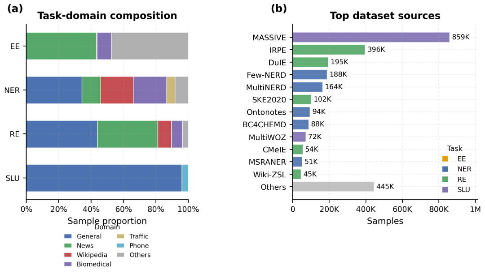

<h1 align="center">Xing4.0-29B-Intent</h1>

<p align="center"><strong>Xing4.0-29B-Intent</strong> — schema-guided intent recognition and structured information extraction, built from a 29B MoE with only 4B activated parameters.</p>

<p align="center">
  🤗 <a href="https://huggingface.co/XingChen-AGI/Xing4.0-29B-Intent">Hugging Face</a> •
  🤖 <a href="https://www.modelscope.cn/models/XingChen-AGI/Xing4.0-29B-Intent">ModelScope</a> •
  🪐 <a href="https://modelers.cn/models/XingChen-AGI/Xing4.0-29B-Intent" target="_blank">Modelers</a> •
  📚 <a href="https://huggingface.co/datasets/XingChen-AGI/Xing4.0-29B-Intent-oss">Dataset</a>
</p>

<div align="center">

[English](./README.md) | [简体中文](./README_zh.md)

</div>


## Contents

- [Introduction](#introduction)
- [Model Information](#model-information)
- [Evaluation Results](#evaluation-results)
- [Quick Start](#quick-start)
- [Companion Dataset](#companion-dataset)
- [License and Citation](#license-and-citation)

## Introduction

**Xing4.0-29B-Intent** is a **schema-guided model for intent recognition and structured information extraction**, developed from [Xing4.0-29B-A4B](https://github.com/XingChen-AGI/Xing4.0-29B-A4B), the Xing semantic large language model from China Telecom Artificial Intelligence Technology Co., Ltd. It converts natural language into structured results for business systems, supporting intelligent assistants, request routing, and document information extraction.

For example, a request such as “Find flights from Beijing to Shanghai tomorrow” needs to be parsed into a flight-search intent and parameters such as origin, destination, and date. Xing4.0-29B-Intent performs recognition and extraction according to the supplied category and field definitions, returning results in a unified JSON format.

### Key Features

- **Four task types, one representation**: intent recognition and slot filling, named entity recognition, relation extraction, and event extraction all use `category + args` to represent results.
- **Schema-guided task configuration**: specify tasks through candidate categories, category descriptions, and field definitions, using the same input/output protocol across business scenarios.
- **Joint recognition and extraction**: identify user intent and its parameters together, with JSON arrays supporting multiple categories and multiple argument instances.
- **Chinese and English use cases**: evaluation covers Chinese and English corpora, including intent understanding in conversations and structured information extraction from text.
- **Companion SDK**: provides schema definitions, prompt assembly, multi-turn conversation input, synchronous and asynchronous calls, and convenient access to structured results.

## Model Information

| Item | Description |
| --- | --- |
| Model name | Xing4.0-29B-Intent |
| Base model | [Xing4.0-29B-A4B](https://huggingface.co/XingChen-AGI/Xing4.0-29B-A4B) |
| Base model parameters | Approximately 29B total, with approximately 4B active per token |
| Focus | Schema-guided intent recognition and structured information extraction |
| Supported tasks | Intent recognition and slot filling, named entity recognition, relation extraction, event extraction |
| Input | Task instructions, schema, and text or conversation |
| Output | A JSON array whose items contain `category` and `args` |
| Languages | Chinese and English |

The base model uses a mixture-of-experts (MoE) architecture. See the [base model overview](https://github.com/XingChen-AGI/Xing4.0-29B-A4B) for technical details. This project focuses on intent recognition and information extraction; performance for specific use cases should be validated using the target data and schema.

### Tasks and Outputs

| Task | Meaning of `category` | Contents of `args` |
| --- | --- | --- |
| Intent recognition and slot filling | User intent | Business parameters associated with the intent |
| Named entity recognition | Entity type | Entity information extracted according to the schema fields |
| Relation extraction | Relation type | Participating entities and other relevant fields |
| Event extraction | Event type | Participants, time, location, and other event fields |

The input schema defines candidate categories and their extractable fields: `category` specifies the category name, while `args` lists field names and descriptions. Model outputs use the corresponding category and field names. Each object in the output `args` array represents one extracted argument instance; when no arguments can be filled, `args` is `[]`.

## Evaluation Results

We evaluate the model on four task types: intent understanding, named entity recognition, relation extraction, and event extraction. The table below presents the currently compiled results on a 0–100 scale, rounded to whole numbers from the original scores.

| Model | Overall | Category | Event Extraction | Named Entity Recognition | Relation Extraction | Intent Understanding |
| --- | ---: | ---: | ---: | ---: | ---: | ---: |
| **Xing4.0-29B-Intent** | **58** | 69 | **40** | **72** | **38** | **81** |
| Gemini-3.6-Flash | 49 | **71** | 30 | 71 | 29 | 64 |
| Qwen3.8-Max | 46 | 71 | 29 | 66 | 26 | 63 |
| Kimi-K3 | 45 | 71 | 28 | 68 | 25 | 61 |
| GPT-5.6-Sol | 45 | 70 | 28 | 68 | 23 | 60 |
| GLM-5.2 | 44 | 70 | 29 | 65 | 25 | 58 |
| GLM-5.3-Flash | 44 | 69 | 27 | 65 | 26 | 58 |
| DeepSeek-V4.1-Flash | 42 | 67 | 26 | 61 | 23 | 56 |
| DeepSeek-V4-Pro | 41 | 67 | 23 | 60 | 24 | 56 |
| LongCat-2.0 | 41 | 68 | 24 | 62 | 23 | 53 |
| GPT-6-Luna | 39 | 64 | 24 | 59 | 20 | 51 |

Note: Bold marks the highest original score in each column, determined before rounding. Identical displayed integers do not necessarily indicate a tie in the original scores.

### Evaluation Notes

- **Evaluation data**: the test set contains 6,000 samples drawn from 48 public datasets, covering named entity recognition, relation extraction, event extraction, and intent understanding. It evaluates the model's ability to identify categories and extract relevant information from input text according to the supplied task instructions and schema.
- **Metric definitions**: each task score is the macro-average of per-dataset field-value Micro-F1 scores. The overall score is the equally weighted average of the four task scores. The category score evaluates only `category` labels and is also aggregated with equal weights across the four task types. Scores are shown on a 0–100 scale and do not represent business accuracy rates.
- **Interpretation**: category scores do not imply that all extracted fields are correct. Interfaces, prompts, and inference settings may also affect results.

## Quick Start

### Start the Model Service

For environment setup and service startup, refer to the base model's [serving instructions (Chinese)](https://github.com/XingChen-AGI/Xing4.0-29B-A4B/blob/main/README_zh.md#服务化推理), which cover compatible environments and deployment instructions for frameworks such as vLLM and SGLang.

Replace the model path in those instructions with the **path to the Xing4.0-29B-Intent weights**, and set `--served-model-name` to `Xing4.0-29B-Intent`. Follow the base model's deployment documentation for framework compatibility requirements, and configure GPU memory usage, parallelism, and context length for your environment.

Once the service is running, the SDK calls it through its OpenAI-compatible API. The example below uses `http://localhost:8000/v1`.

### Install and Use the SDK

The companion [XingIntent SDK](XingIntentSDK/README.md) lets you define business intents and retrieve structured results. After downloading or cloning this repository, run the following commands from the repository root:

```bash
cd XingIntentSDK
python -m pip install -e .
```

Then call the model service with the following example. Replace `base_url` and `model` with your service address and model name. The Chinese input and schema are retained from the Chinese README so that both versions show the same example.

```python
from xingintent import Arg, Intent, IntentClient

client = IntentClient(
    base_url="http://localhost:8000/v1",
    model="Xing4.0-29B-Intent",
    max_tokens=512,
)
result = client.predict(
    text="帮我查明天北京到上海的航班。",
    intents=[
        Intent(
            "查询航班",
            "查询指定日期与路线的航班",
            args=[
                Arg("出发地", "出发城市"),
                Arg("目的地", "到达城市"),
                Arg("日期", "用户提到的出行日期，保留原文"),
            ],
        )
    ],
)
print(result.category)
print(result.args)
```

Expected printed output:

```text
查询航班
{'出发地': '北京', '目的地': '上海', '日期': '明天'}
```

`result.category` and `result.args` are convenience properties provided by the SDK. They return the first predicted category and its merged argument dictionary, respectively. For multiple categories or multiple argument instances, iterate over `result.intents` and read each item's `category` and `args` to preserve the full structure.

The SDK handles prompt assembly and result parsing automatically. For multi-turn conversations, asynchronous calls, loading schemas from files, and constrained decoding, see the [SDK documentation](XingIntentSDK/README.md). More examples are available under [SDK examples](XingIntentSDK/examples/).

## Companion Dataset

The companion open-source dataset, **Xing4.0-29B-Intent-oss**, brings **61 public datasets** and **China Telecom's in-house data for smart device assistants** into a unified schema-guided representation. It contains approximately **2.75 million samples** spanning **4 task types, 19 domains, and 52 languages**, together with a standard smart assistant label set covering **170+ intents and 148 slots**. These reusable **data and task definitions** support model fine-tuning, evaluation, and deployment in business scenarios.

- **Unified format, reusable pipelines**: Intent recognition and slot filling (SLU), named entity recognition (NER), relation extraction (RE), and event extraction (EE) share the `category + args` format, reducing cross-task data conversion and making processing and training pipelines easier to reuse.
- **General corpora and business scenarios**: The dataset combines the task and domain breadth of public corpora with intent and slot annotations for smart device assistants, supporting both research on general capabilities and adaptation to business scenarios.
- **Ready-made labels to accelerate task definition**: The assistant intent and slot definitions provide an initial schema for new projects. They can be tailored or extended to business needs, reducing the effort of designing a label system from scratch.
- **Flexible data mixtures for business customization**: Samples from the open-source dataset can be mixed with in-house business data at chosen ratios for supervised fine-tuning (SFT). The included schemas and example-building scripts connect task definition, data preparation, and model training.

<p align="center">
  
  <br>
  <em>Domain distribution by task (left) and major dataset source sizes (right).</em>
</p>

- [Hugging Face dataset page](https://huggingface.co/datasets/XingChen-AGI/Xing4.0-29B-Intent-oss): dataset overview.
- [Dataset documentation](data/README.md): detailed distributions, schemas, field definitions, and example assembly instructions.
- [CMPA-SLU benchmark for Chinese spoken language understanding](https://github.com/XingChen-AGI/CMPA-SLU): developed by the Xingchen AGI Lab for intelligent interactions on mobile devices. The accompanying paper, "CMPA-SLU: A Benchmark for Chinese Mobile Personal Assistant Spoken Language Understanding," has been accepted to EMNLP 2026.

## License and Citation

### License

The model weights, public data, and code (including the Python SDK) are released under the [Apache License 2.0](LICENSE).

### Citation

If this project helps your research or applications, please consider citing it and the related work on its base model.

```bibtex
@misc{xingchen2026xingintent,
  title        = {Xing4.0-29B-Intent},
  author       = {{XingChen-AGI}},
  year         = {2026},
  howpublished = {GitHub repository},
  url          = {https://github.com/XingChen-AGI/Xing4.0-29B-Intent}
}

@misc{liu2025trainingreporttelechat3moe,
      title={Training Report of TeleChat3-MoE}, 
      author={Xinzhang Liu and Chao Wang and Zhihao Yang and Zhuo Jiang and Xuncheng Zhao and Haoran Wang and Lei Li and Dongdong He and Luobin Liu and Kaizhe Yuan and Han Gao and Zihan Wang and Yitong Yao and Sishi Xiong and Wenmin Deng and Haowei He and Kaidong Yu and Yu Zhao and Ruiyu Fang and Yuhao Jiang and Yingyan Li and Xiaohui Hu and Xi Yu and Jingqi Li and Yanwei Liu and Qingli Li and Xinyu Shi and Junhao Niu and Chengnuo Huang and Yao Xiao and Ruiwen Wang and Fengkai Li and Luwen Pu and Kaipeng Jia and Fubei Yao and Yuyao Huang and Xuewei He and Zhuoru Jiang and Ruiting Song and Rui Xue and Qiyi Xie and Jie Zhang and Zilu Huang and Zhaoxi Zhang and Zhilong Lu and Yanhan Zhang and Yin Zhang and Yanlei Xue and Zhu Yuan and Teng Su and Xin Jiang and Shuangyong Song and Yongxiang Li and Xuelong Li},
      year={2025},
      eprint={2512.24157},
      archivePrefix={arXiv},
      primaryClass={cs.CL},
      url={https://arxiv.org/abs/2512.24157}, 
}

@misc{wang2025technicalreporttelechat2telechat25,
      title={Technical Report of TeleChat2, TeleChat2.5 and T1}, 
      author={Zihan Wang and Xinzhang Liu and Yitong Yao and Chao Wang and Yu Zhao and Zhihao Yang and Wenmin Deng and Kaipeng Jia and Jiaxin Peng and Yuyao Huang and Sishi Xiong and Zhuo Jiang and Kaidong Yu and Xiaohui Hu and Fubei Yao and Ruiyu Fang and Zhuoru Jiang and Ruiting Song and Qiyi Xie and Rui Xue and Xuewei He and Yanlei Xue and Zhu Yuan and Zhaoxi Zhang and Zilu Huang and Shiquan Wang and Xin Wang and Hanming Wu and Mingyuan Wang and Xufeng Zhan and Yuhan Sun and Zhaohu Xing and Yuhao Jiang and Bingkai Yang and Shuangyong Song and Yongxiang Li and Zhongjiang He and Xuelong Li},
      year={2025},
      eprint={2507.18013},
      archivePrefix={arXiv},
      primaryClass={cs.CL},
      url={https://arxiv.org/abs/2507.18013}, 
}
```
